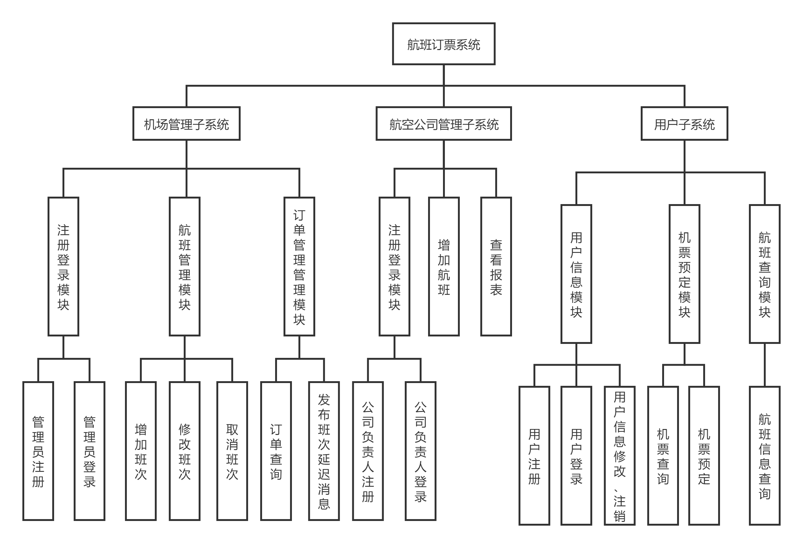
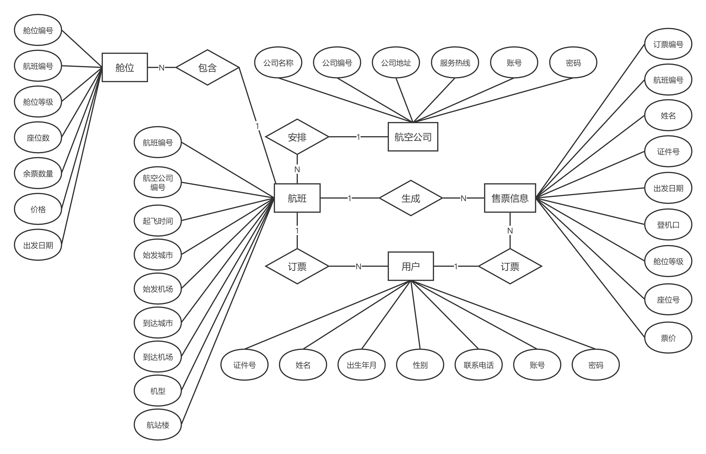

# 航空订票管理系统

一个基于 **Python、PyQt5 和 PostgreSQL 兼容数据库**实现的桌面端航空订票管理系统。系统包含乘客、管理员和航空公司三类角色，覆盖航班查询、订票退票、航班与舱位维护、订单管理等基本业务流程。

> 本项目当前为课程/原型项目。代码仓库中没有数据库建表与初始化 SQL，首次运行前需要根据 E-R 图创建数据库、数据表和对应权限角色。

## 功能概览

### 乘客端

- 乘客注册与登录
- 查看全部航班
- 按出发地、目的地和日期查询航班
- 选择舱位、生成订单和座位号
- 查询个人订单并取消订单
- 查看与修改个人资料

### 管理员端

- 管理员注册与登录
- 按航班号或航空公司查询航班
- 新增、修改和删除航班
- 维护头等舱、商务舱和经济舱的班次、座位及价格
- 按日期、地点或乘客姓名查询订单
- 调整订单舱位与座位

### 航空公司端

- 航空公司注册与登录
- 查看本公司的航班
- 查看和修改公司资料

## 系统设计

### 功能模块图



### E-R 图



代码中使用到的主要数据表包括：`passenger`、`administrator`、`company`、`flight`、`cabin`、`ticket` 和 `Refund`。

## 技术栈

- Python 3.9（推荐；项目代码也兼容相近的 Python 3 版本）
- PyQt5 5.15.4
- psycopg2 / PostgreSQL 协议兼容数据库
- Qt Designer `.ui` 界面文件

## 项目结构

```text
.
├── main.py                  # 程序入口、窗口控制与业务逻辑
├── db_config.py             # 从环境变量加载数据库连接配置
├── requirements.txt         # Python 依赖
├── .env.example             # 本地数据库配置模板
├── ui/                      # Qt Designer 源文件与资源文件
├── hello.py                 # 欢迎页 UI
├── uerlogin.py              # 乘客登录 UI（原项目文件名）
├── user_register.py         # 乘客注册 UI
├── order.py                 # 查询、订票与订单 UI
├── admin_login.py           # 管理员/航空公司登录 UI
├── admin_register.py        # 管理员注册 UI
├── manage.py                # 管理员后台 UI
├── company_register.py      # 航空公司注册 UI
├── company_manage.py        # 航空公司后台 UI
├── 系统功能模块图.jpg
└── 系统E-R图.jpg
```

> `uerlogin.py` 的文件名虽然存在拼写问题，但已被 `main.py` 直接导入；如需重命名，请同步修改导入语句。

## 本地运行

### 1. 创建虚拟环境

Windows PowerShell：

```powershell
python -m venv .venv
.\.venv\Scripts\Activate.ps1
```

macOS / Linux：

```bash
python3 -m venv .venv
source .venv/bin/activate
```

### 2. 安装依赖

```bash
python -m pip install --upgrade pip
python -m pip install -r requirements.txt
```

### 3. 配置数据库

先复制配置模板：

```powershell
Copy-Item .env.example .env
```

macOS / Linux 可使用：

```bash
cp .env.example .env
```

然后编辑 `.env`：

```dotenv
DB_NAME=dbflight_ticket_book
DB_HOST=127.0.0.1
DB_PORT=5432

DB_PASSENGER_USER=passenger_user
DB_PASSENGER_PASSWORD=your_password
DB_ADMIN_USER=admin_user
DB_ADMIN_PASSWORD=your_password
DB_COMPANY_USER=company_user
DB_COMPANY_PASSWORD=your_password
```

三个数据库账号应分别拥有乘客端、管理员端和航空公司端所需的数据表权限。`.env` 已被 `.gitignore` 排除，不要把真实账号、密码或公网数据库地址提交到 GitHub。

### 4. 准备数据库

创建 `dbflight_ticket_book` 数据库，并根据仓库中的 E-R 图建立以下核心表：

- `passenger`：乘客资料和登录信息
- `administrator`：管理员登录信息
- `company`：航空公司资料和登录信息
- `flight`：航班基础信息
- `cabin`：航班日期、舱位、座位和价格
- `ticket`：订单与出票信息
- `Refund`：退票相关记录

当前仓库没有可自动执行的建表脚本。如果数据库尚未建立，需要先补充 `schema.sql` 和必要的初始数据，再启动程序。

### 5. 启动程序

```bash
python main.py
```

## 发布到 GitHub

先在 GitHub 新建一个空仓库，不要勾选自动创建 README、`.gitignore` 或 License。将下面的 `<用户名>` 和 `<仓库名>` 替换为实际值：

```bash
git init
git branch -M main
git add .
git status
git commit -m "chore: initial project import"
git remote add origin https://github.com/<用户名>/<仓库名>.git
git push -u origin main
```

提交前建议确认没有敏感配置进入暂存区：

```bash
git status
git diff --cached
git check-ignore -v .env
```

如果已经配置过远程仓库，可查看或修改地址：

```bash
git remote -v
git remote set-url origin https://github.com/<用户名>/<仓库名>.git
```

## 日常版本管理

查看和提交修改：

```bash
git status
git diff
git add <文件名>
git commit -m "feat: describe the change"
git pull --rebase origin main
git push origin main
```

使用功能分支开发：

```bash
git switch -c feature/<功能名>
git add .
git commit -m "feat: add <功能名>"
git push -u origin feature/<功能名>
```

发布版本标签：

```bash
git tag -a v0.1.0 -m "release v0.1.0"
git push origin v0.1.0
```

常用安全撤销命令：

```bash
# 丢弃某个尚未暂存文件的本地修改
git restore <文件名>

# 将文件移出暂存区，但保留本地修改
git restore --staged <文件名>

# 用一个新提交撤销已经公开的提交
git revert <提交哈希>
```

## 当前限制与改进建议

- 缺少数据库建表、权限配置和初始化数据脚本。
- 部分 SQL 使用字符串拼接，正式部署前应改为参数化查询，避免 SQL 注入。
- 账号密码目前以明文形式参与业务逻辑，正式使用时应采用安全的密码哈希方案。
- 业务逻辑主要集中在 `main.py`，后续可拆分为界面层、服务层和数据访问层。
- 当前没有自动化测试，修改订票、退票和余票逻辑后需要重点回归测试。

## License

项目暂未附带开源许可证。公开仓库如需允许他人使用、修改或分发，请根据实际需求补充合适的 License。
